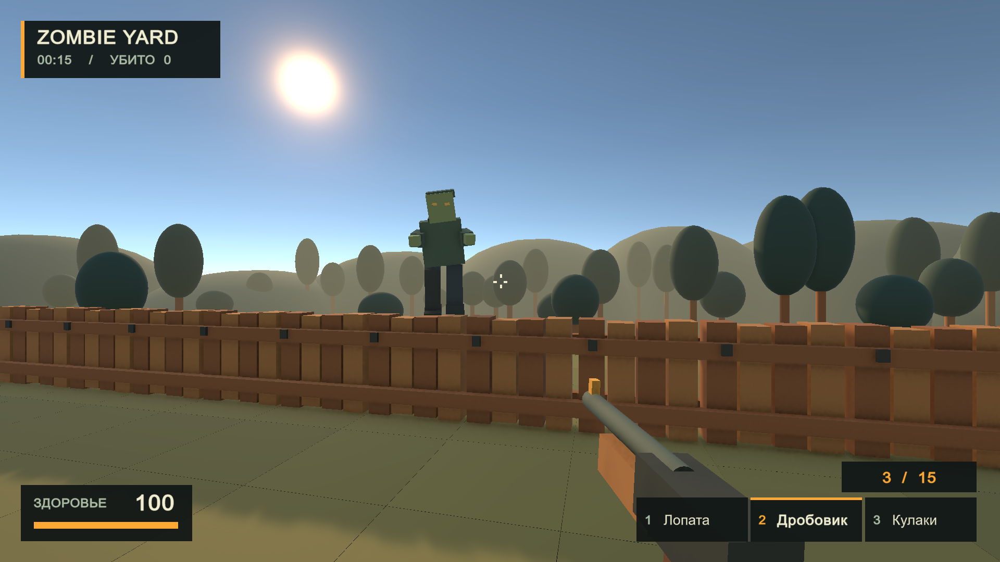

# ZombieYard

Прототип игры на выживание от первого лица для Windows. Игрок начинает с лопатой и дробовиком на огороженном участке. Зомби перелезают через ограду, а игрок может изменить их маршрут, разрушив блок. Участок, оружие и персонажи собраны из примитивов Unity.

## Запуск из исходников

1. Добавь корневую папку проекта в Unity Hub и открой её в Unity **6000.3.22f1**. Для восстановления Git-зависимостей VContainer и Unity MCP нужен Git в PATH и доступ к их источникам. [Версия редактора](ProjectSettings/ProjectVersion.txt) · [Зависимости](Packages/manifest.json)
2. Дождись импорта ассетов и завершения компиляции. В окне Project открой [игровую сцену Yard](Assets/General/Scenes/Yard.unity), нажми Play и щёлкни в Game View.
3. Для движения используй WASD, для атаки — ЛКМ. Слоты переключаются клавишами 1–3. Оружие подбирается клавишей E, патроны — при приближении. Полная раскладка доступна по Esc и в [описании прототипа](Docs/ARCHITECTURE.md).

## Проверка и сборка

- **Тесты.** Открой `Window → General → Test Runner`. По очереди запусти EditMode и PlayMode. Для автоматической проверки боя, подбора, ям и спавна PlayMode-тесты загружают сцену Yard. [Покрытие тестами](Docs/IMPLEMENTATION_STATUS.md)
- **Windows x64.** В `File → Build Profiles` выбери Windows и архитектуру Intel 64-bit. В Scene List первой должна стоять сцена Yard. Нажми Build и выбери `Builds/Windows`. Запускай `ZombieYard.exe` из этой папки. При передаче сборки сохрани рядом с ним папку данных и библиотеки Unity. [Список сцен](ProjectSettings/EditorBuildSettings.asset)

## Что хранить в Git

Добавляй авторские файлы из `Assets/` вместе с созданными Unity файлами `.meta`, оба файла зависимостей из `Packages/`, настройки из `ProjectSettings/` и документацию из `Docs/`. GUID из `.meta` связывают сцену с префабами, материалами и конфигами. Проект использует Visible Meta Files и текстовую сериализацию Unity. Правила Git исключают локальные сборки, кэш и файлы IDE. [Исключения](.gitignore) · [Атрибуты файлов](.gitattributes)

## Карта документации

| Вопрос | Где искать |
| --- | --- |
| Какие механики и критерии приёмки заданы для v1? | [ТЗ v4](Docs/ZombieYard_TZ_v4.md) |
| Как устроены сцена, данные и код? | [Архитектура](Docs/ARCHITECTURE.md) |
| Какие версии пакетов нужны проекту? | [Технический стек](Docs/TECH_STACK.md) |
| Что уже работает и чем это проверено? | [Состояние реализации](Docs/IMPLEMENTATION_STATUS.md) |
| Почему яма, дробь и подбор устроены именно так? | [Принятые решения](Docs/DECISIONS.md) |
| Что проверить перед следующей сборкой? | [План проверки v1](Docs/ROADMAP.md) |
| Как работать агенту в этом проекте? | [Инструкции агенту](AGENTS.md) |
